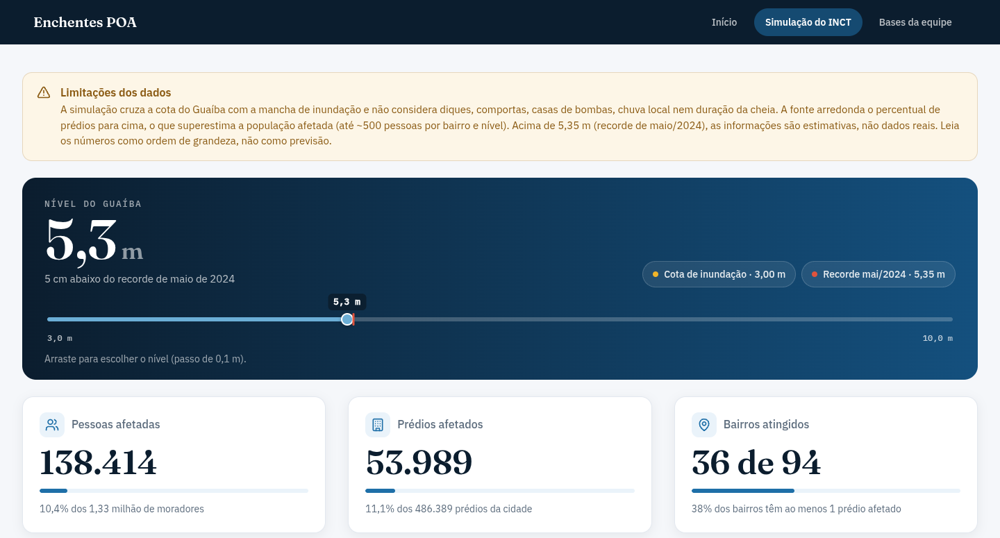
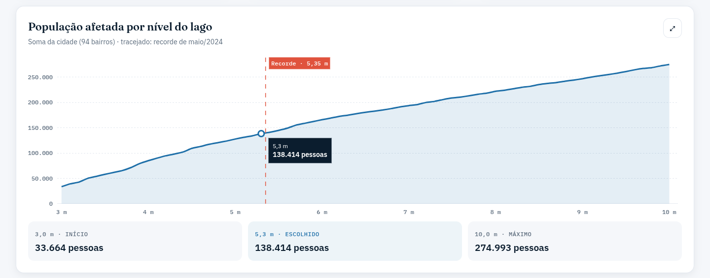
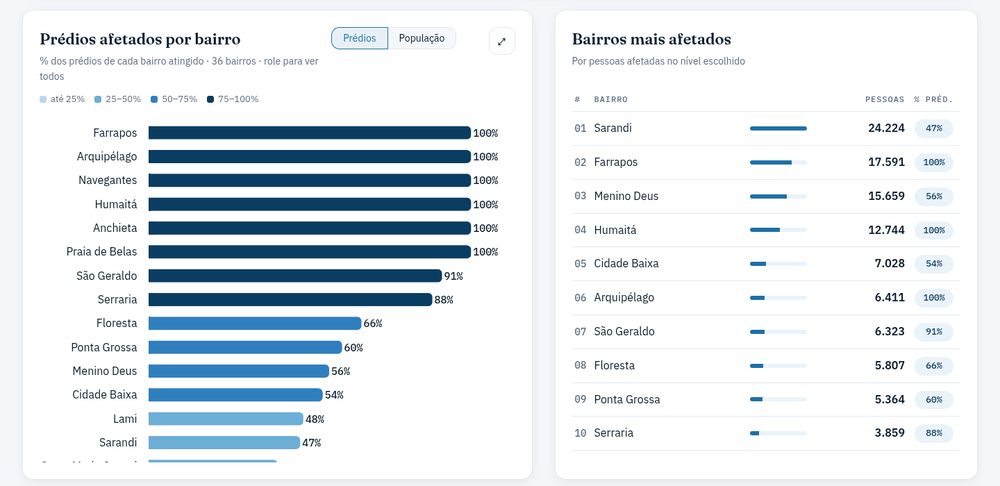
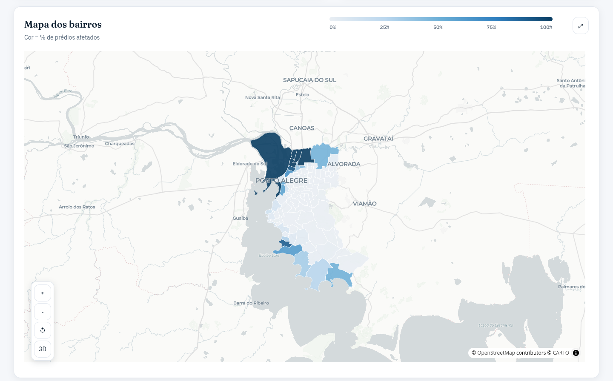
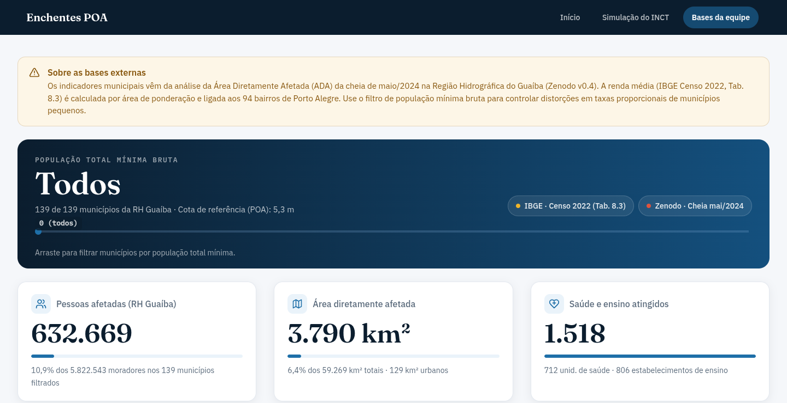
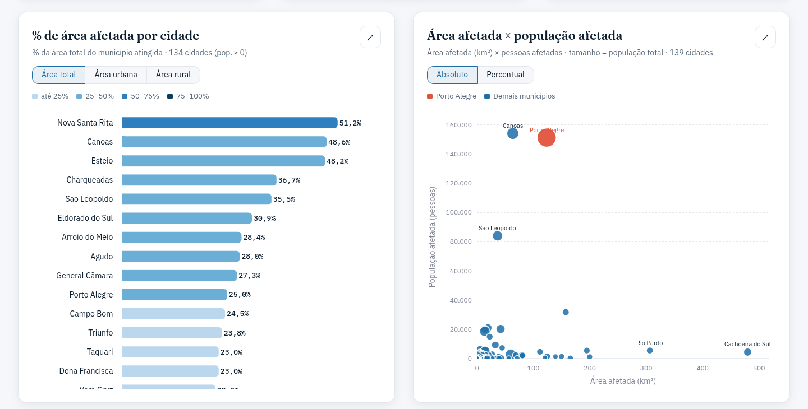
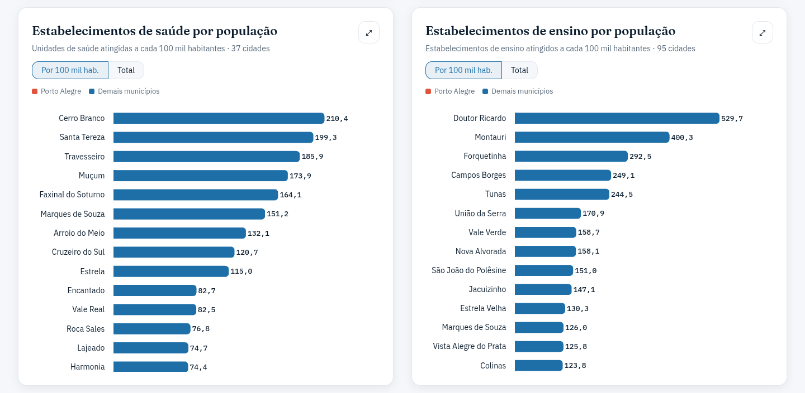
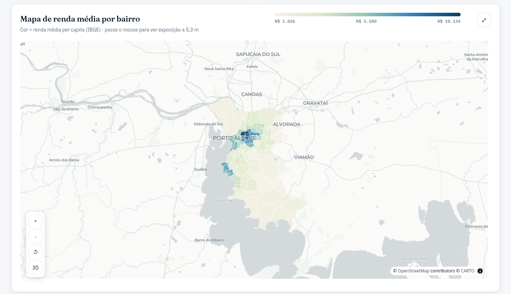
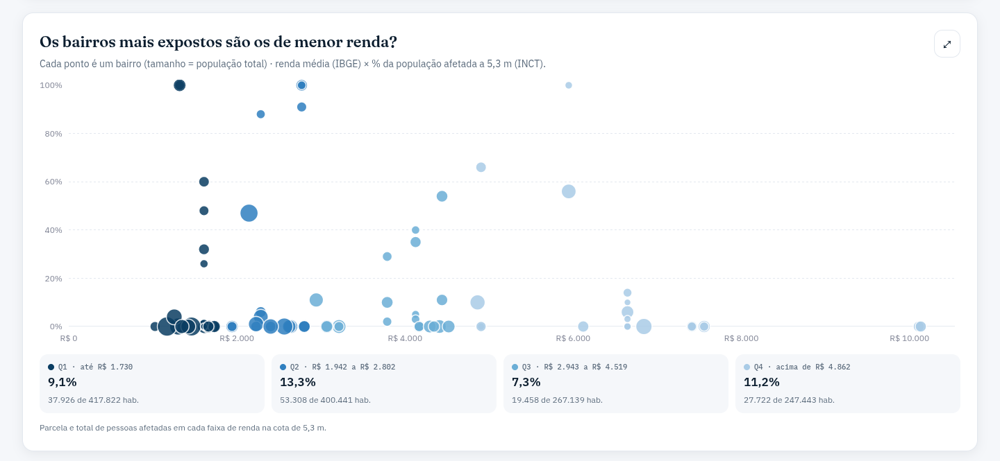
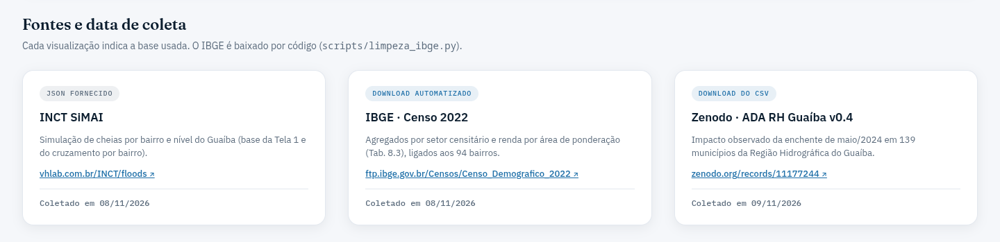

# Relatório: Dashboard

Projeto extensionista — Coleta, Preparação e Análise de Dados (PUCRS)
Equipe: Henrique Vitor Mairesse, Matheus de Oliveira Kur e Tarciso Mota Ney da Silva
Repositório: https://github.com/matheuskur/es-cpad-te

## 1. Visão geral

O dashboard responde a duas perguntas sobre as enchentes em Porto Alegre:

1. **Tela 1 — Simulação do INCT:** se o Guaíba chegar a X metros, quais bairros e quantas pessoas são afetados?
2. **Tela 2 — Bases da equipe:** o que outras bases sobre enchentes no RS acrescentam a essa resposta?

| Item | Descrição |
|------|-----------|
| Repositório | https://github.com/matheuskur/es-cpad-te |
| Ferramenta | Streamlit 1.66 com gráficos Plotly 7.1 (Python) |
| Código | `app/app.py` (navegação), `app/paginas/` (telas), `app/utils/dados.py` (leitura dos dados processados), `app/utils/estilo.py` (cores, tipografia e componentes visuais), `.streamlit/config.toml` (tema) |
| Dados usados | `dados/processados/INCT/inct_limpo.json`, `dados/processados/IBGE/bairros_poa.csv`, `dados/processados/zenodo/analise_ada_rhguaiba_municipios.csv`, `dados/processados/geo/bairros_poa.geojson` |
| Como rodar | `python scripts/preparar_dados.py` (opcional, reproduz os dados processados) e `streamlit run app/app.py`, a partir da raiz, depois de instalar o `requirements.txt` (ver o README) |
| Link público | _a definir_ (Streamlit Community Cloud) |

O app tem três páginas no menu superior: **Início**, **Simulação do INCT** (Tela 1) e **Bases da equipe** (Tela 2). O dashboard só lê arquivos já processados. Toda a limpeza é feita antes pelos scripts de `scripts/` (todos de uma vez com `python scripts/preparar_dados.py`) e está documentada em `relatorios/limpeza_dados.md`. Os dados são carregados com `st.cache_data`, então as interações não releem os arquivos.

## 2. Ponto de partida: a ferramenta atual do INCT

Antes de desenhar o dashboard, a equipe explorou a página Flood — INCT SiMAI (http://vhlab.com.br/INCT/floods/). Ela é um aplicativo web (Angular com mapa Leaflet) que roda em servidor próprio e busca os dados de inundação, de edificações e de nível do rio sob demanda.

**O que funciona:**
- O mapa é detalhado: mostra a região inundada e permite consultar prédios dentro de uma grade selecionada.
- Há busca por endereço, que informa a partir de qual nível o local começa a alagar ("A inundação começa aproximadamente em…") e a distância até a área inundada.
- Traz serviços afetados (unidades de saúde, farmácias, educação), histórico do nível d'água (ANA) e estimativa de rotas de evacuação a pé.
- Está em português e inglês e cita as fontes (OpenStreetMap, Prefeitura de Porto Alegre, ANA e Coastal Climate Change).

**O que atrapalha:**
- **Lentidão e instabilidade.** Cada etapa depende de uma requisição ao servidor e passa por telas de espera ("Carregando dados de inundação", "Carregando dados de edificações", "Carregando dados de nível…"). Quando o servidor falha, a página mostra mensagens como "Falha ao buscar dados de edificações, por favor tente novamente mais tarde" ou "Dados de nível indisponíveis no momento".
- **A pergunta principal não tem resposta direta.** A ferramenta é centrada em um endereço ou em uma grade do mapa ("Envie um endereço para visualizar o mapa"). Não há uma visão rápida de "a X metros, quantas pessoas e quais bairros são afetados na cidade".
- **Não há comparação entre bairros.** Não existe ranking nem gráfico com a porcentagem de prédios afetados por bairro; é preciso consultar área por área.
- **Não há curva por nível.** Não é possível ver como a população afetada cresce de 3,0 m a 10,0 m, nem onde fica o recorde de maio de 2024 nessa curva.
- **Limitações pouco visíveis.** Não há um aviso destacado de que os números são estimativas de uma simulação, nem de como a população afetada é calculada.

**Como isso orientou o dashboard:**

| Problema observado | Resposta no dashboard |
|--------------------|-----------------------|
| Lentidão e dependência de servidor próprio | Dados pré-processados em arquivos pequenos, lidos uma vez e guardados em cache; publicação em serviço gratuito e estável |
| Falta de resposta direta para a cidade | Controle deslizante único com três indicadores no topo (pessoas, prédios e bairros) |
| Falta de comparação entre bairros | Gráfico de % de prédios por bairro, ranking dos 10 bairros e mapa colorido |
| Falta de visão por nível | Curva da população afetada de 3,0 m a 10,0 m com o recorde de 5,35 m marcado |
| Limitações pouco visíveis | Aviso de cor amarelada no topo de cada tela, antes de qualquer número |

## 3. Tela 1 — Simulação do INCT

### 3.1. Objetivo

Responder em poucos segundos: **se o Guaíba chegar a X metros, quais bairros e quantas pessoas são afetados?** A tela usa apenas o JSON do INCT depois de limpo (`dados/processados/INCT/inct_limpo.json`, 6.674 linhas: 71 níveis × 94 bairros).

### 3.2. Visualizações escolhidas

**1. Aviso de limitações (topo).** O aviso de cor amarelada é o primeiro elemento exibido na página. Ele informa que a simulação não considera diques, comportas, casas de bombas, chuva local nem a duração da cheia; que o arredondamento para cima do percentual de prédios afetados superestima a população afetada (em até cerca de 500 pessoas por bairro e nível); e que os valores devem ser interpretados como ordem de grandeza, e não como previsão.

**2. Controle deslizante do nível do Guaíba.** Vai de 3,0 m a 10,0 m em passos de 0,1 m e atualiza todos os elementos da tela. Foi feito como componente próprio (`st.components.v2`) para mostrar o valor sobre o cursor e uma marca vermelha no recorde de 5,35 m. A trilha fica azul até o recorde e laranja acima dele, indicando a faixa em que os níveis nunca foram observados. Acima do controle, o nível escolhido aparece em destaque, com a distância até o recorde ("5 cm abaixo do recorde de maio de 2024"). Por ser o único controle da tela, ele ocupa posição central e de destaque. A marca do recorde oferece uma referência concreta e amplamente conhecida pela população de Porto Alegre. O valor é enviado apenas quando o cursor é solto, o que evita recalcular a página durante o arraste.

**3. Indicadores no topo.** Três cartões: **pessoas afetadas**, **prédios afetados** e **bairros atingidos** (com ao menos um prédio afetado). Cada um tem uma barra com a fração da cidade e o texto de contexto (ex.: "10,4% dos 1,33 milhão de moradores"). Os indicadores respondem à pergunta da tela em uma única linha, e a barra e o percentual evitam que o valor absoluto seja interpretado sem escala.

Valores de referência (dados limpos):

| Nível | Pessoas afetadas | Prédios afetados | Bairros atingidos |
|------:|-----------------:|-----------------:|------------------:|
| 3,0 m | 33.664 | 14.655 | 24 de 94 |
| 4,0 m | 84.970 | 32.784 | 33 de 94 |
| 5,3 m | 138.414 | 53.989 | 36 de 94 |
| 6,0 m | 165.811 | 64.494 | 39 de 94 |
| 8,0 m | 221.899 | 83.017 | 49 de 94 |
| 10,0 m | 274.993 | 101.219 | 54 de 94 |

**4. Curva da população afetada por nível.** Gráfico de área com a soma da cidade para os 71 níveis, uma linha tracejada vermelha no recorde de 5,35 m e um marcador no nível escolhido com o valor. Abaixo, três resumos: início (3,0 m), nível escolhido e máximo (10,0 m). O gráfico de linha é adequado para representar uma grandeza contínua em função do nível e permite visualizar, ao mesmo tempo, a tendência, a posição do nível escolhido e o agravamento da situação acima do recorde. A curva depende da limpeza dos dados: no arquivo original, o Centro Histórico apresentava valor zero em 9,7 m e 9,8 m, o que produzia uma queda de mais de 12 mil pessoas na curva da cidade.

**5. Gráfico de % de prédios afetados por bairro.** Barras horizontais, uma por bairro atingido, ordenadas da maior para a menor porcentagem. A cor segue quatro faixas (até 25%, 25–50%, 50–75%, 75–100%), em tons de azul. Um seletor troca a métrica entre **Prédios** e **População**, e o tooltip mostra os valores absolutos (ex.: Sarandi a 5,3 m, "47% dos prédios — 10.009 de 21.680"). As barras horizontais acomodam os nomes extensos dos bairros e permitem comparar comprimentos com precisão. A ordenação identifica os bairros mais atingidos sem exigir a leitura da lista completa, e as faixas de cor agilizam a leitura e mantêm coerência com o mapa.

**6. Ranking dos bairros mais afetados.** Tabela com os 10 bairros com mais pessoas afetadas no nível escolhido, com posição, barra proporcional, número de pessoas e % de prédios. O ranking complementa o gráfico anterior: enquanto o gráfico ordena os bairros por porcentagem, o que coloca no topo bairros pequenos totalmente alagados, o ranking os ordena pelo número de pessoas, informação mais relevante para a defesa civil. A 5,3 m, por exemplo, Sarandi tem 47% dos prédios afetados, mas ocupa o primeiro lugar do ranking, com 24.224 pessoas; Farrapos (100%) ocupa o segundo, com 17.591.

**7. Mapa dos bairros (diferencial opcional).** Mapa coroplético dos 94 bairros, colorido pela % de prédios afetados, em escala contínua do cinza-azulado claro (0%) ao azul escuro (100%). O tooltip mostra o bairro, a porcentagem e as pessoas afetadas. Tem botões de zoom, de retorno à vista inicial e de visualização em plano inclinado (3D). O mapa acrescenta a dimensão geográfica, ausente nos gráficos: a água avança pelo norte (Arquipélago, Humaitá, Farrapos e Navegantes) e pela orla sul. A malha provém do IBGE (Censo 2022) e é associada aos bairros do INCT pelo código do bairro (`scripts/malha_bairros.py`), e não pelo nome, o que evita erros de grafia.

**Escolhas visuais gerais.** Paleta em azul (água) para os dados e vermelho apenas para o recorde de 2024, sem vermelho para "perigo" nem cores alarmantes, de modo a informar sem alarmar. Números com separador de milhar brasileiro e vírgula decimal. Cada gráfico tem botão para expandir em largura total, útil em apresentações e telas pequenas.

### 3.3. Como usar

1. Abra a página **Simulação do INCT** no menu superior.
2. Leia o aviso de limitações.
3. Arraste o controle até o nível desejado e solte. O nível aparece em destaque, com a distância até o recorde de 5,35 m.
4. Leia os três indicadores: pessoas, prédios e bairros afetados nesse nível.
5. Na curva, veja onde o nível escolhido está em relação ao recorde e ao máximo simulado.
6. No gráfico de barras, veja quais bairros são atingidos e em que proporção; use **Prédios / População** para trocar a métrica e passe o mouse para ver os valores absolutos. Role a lista para ver todos os bairros.
7. No ranking, veja os 10 bairros com mais pessoas afetadas.
8. No mapa, passe o mouse sobre os bairros; use **+ / −** para zoom, **↺** para voltar e **3D** para o plano inclinado.
9. Use o botão **⤢** de cada cartão para expandir o gráfico e **⤡** para reduzir.

## 4. Tela 2 — Bases da equipe

### 4.1. Objetivo

Mostrar o que outras bases acrescentam à simulação, com duas perguntas:

- **Contexto regional (Zenodo):** como foi o impacto observado da enchente de maio de 2024 em Porto Alegre e nos outros 138 municípios da Região Hidrográfica do Guaíba?
- **Ligação com a Tela 1 (IBGE × INCT):** os bairros mais expostos na simulação são os de menor renda?

**Bases usadas:**

| Base | Forma de coleta | Uso na tela | Data de coleta |
|------|-----------------|-------------|----------------|
| INCT SiMAI (`inct_limpo.json`) | JSON fornecido | Exposição por bairro a 5,3 m | 08/11/2026 |
| IBGE, Censo 2022 (Tab. 8.3 e agregados por setor) | Download automatizado por script (`scripts/limpeza_ibge.py`) | Renda média por bairro | 08/11/2026 |
| Zenodo, ADA RH Guaíba v0.4 | Download do CSV | Impacto observado por município em maio/2024 | 09/11/2026 |

### 4.2. Visualizações escolhidas

**1. Aviso sobre as bases.** Igual ao da Tela 1: explica de onde vêm os indicadores municipais (ADA de maio/2024), como a renda é calculada (por área de ponderação, ligada aos 94 bairros) e por que existe o filtro de população.

**2. Filtro interativo: população mínima.** Controle deslizante em escala logarítmica (0, 1.000, 1.500, … 500.000, 1.000.000 habitantes) que filtra os municípios do Zenodo por população total em 2022. Atualiza os indicadores e os quatro gráficos municipais. A RH Guaíba reúne muitos municípios de pequeno porte, nos quais taxas como "estabelecimentos por 100 mil habitantes" se tornam elevadas com poucos casos (por exemplo, Doutor Ricardo, com 529,7 estabelecimentos de ensino atingidos por 100 mil habitantes). O filtro permite eliminar esse efeito e comparar apenas os municípios maiores. A escala logarítmica é necessária porque a população varia de algumas centenas a 1,3 milhão de habitantes.

**3. Indicadores.** Pessoas afetadas, área diretamente afetada (km² e km² urbanos) e estabelecimentos de saúde e ensino atingidos, para os municípios filtrados. Sem filtro: 632.669 pessoas (10,9% de 5,8 milhões), 3.790 km² e 1.518 estabelecimentos (712 de saúde e 806 de ensino).

**4. % de área afetada por cidade.** Barras horizontais ordenadas, com as mesmas faixas de cor da Tela 1. Um seletor alterna entre **área total**, **área urbana** e **área rural**. O gráfico identifica os municípios com maior parcela do território alagada, e a divisão entre área urbana e rural evita confundir uma várzea rural alagada com uma área urbana alagada. Porto Alegre teve 25,0% da área total afetada (21,2% da área urbana); Nova Santa Rita, Canoas e Esteio superam 48%.

**5. Área afetada × população afetada.** Gráfico de dispersão, um ponto por município, com tamanho proporcional à população e Porto Alegre em destaque (vermelho). Alterna entre valores **absolutos** e **percentuais**, e os municípios extremos são rotulados. A dispersão evidencia que área alagada e população afetada não variam na mesma proporção: Cachoeira do Sul e Rio Pardo apresentam grande área atingida e poucas pessoas afetadas, enquanto Canoas (154.002 pessoas, 44,3% da população) e Porto Alegre (151.141 pessoas, 11,3%) concentram as pessoas afetadas em áreas menores. No modo percentual, destaca-se Eldorado do Sul, com 80,3% da população afetada.

**6. Estabelecimentos de saúde e de ensino atingidos.** Dois gráficos de barras lado a lado, com seletor **por 100 mil habitantes / total**. Porto Alegre em vermelho, demais em azul. Os gráficos indicam quantas escolas e unidades de saúde ficaram em área alagada. O total aponta onde há mais equipamentos atingidos (Porto Alegre: 262 de saúde e 231 de ensino), e a taxa indica onde o impacto é maior em relação ao porte do município. A combinação dos dois modos com o filtro de população reduz o risco de conclusões equivocadas.

**7. Mapa de renda média por bairro (ligação com a Tela 1).** Mapa coroplético dos 94 bairros colorido pela renda domiciliar per capita média (IBGE), de R$ 1.026 a R$ 10.134. O tooltip mostra a renda, o quartil e a exposição na simulação a 5,3 m (% da população e pessoas afetadas). Tem os mesmos controles do mapa da Tela 1. O mapa apresenta a renda sobre a mesma geografia do mapa de inundação da Tela 1, permitindo a comparação visual entre ambos. A escala de cor difere da utilizada na Tela 1 (do bege ao azul) para que a renda não seja confundida com a área alagada.

**8. Os bairros mais expostos são os de menor renda? (ligação com a Tela 1).** Dispersão com um ponto por bairro: renda média (IBGE) no eixo x e % da população afetada a 5,3 m (INCT) no eixo y, com tamanho pela população e cor pelo quartil de renda. Abaixo, quatro cartões com a parcela de pessoas afetadas em cada quartil. Esta é a visualização que relaciona diretamente as bases externas à Tela 1, por meio dos bairros: o gráfico de dispersão mostra a relação bairro a bairro, e os cartões a resumem por faixa de renda.

Resultado a 5,3 m:

| Quartil | Renda média do bairro | Bairros | Pessoas afetadas | % afetada |
|---------|-----------------------|--------:|-----------------:|----------:|
| Q1 | até R$ 1.730 | 24 | 37.926 de 417.822 | 9,1% |
| Q2 | R$ 1.942 a R$ 2.802 | 23 | 53.308 de 400.441 | 13,3% |
| Q3 | R$ 2.943 a R$ 4.519 | 23 | 19.458 de 267.139 | 7,3% |
| Q4 | acima de R$ 4.862 | 24 | 27.722 de 247.443 | 11,2% |

**Leitura:** não há um padrão simples de "quanto menor a renda, maior a exposição". A correlação de Spearman entre renda e % da população afetada é de −0,08, praticamente nula. A exposição se concentra em bairros específicos ao longo da orla, de rendas variadas: Farrapos (Q1) e Humaitá (Q2), 100% afetados, mas também Cidade Baixa (Q3) e Menino Deus (Q4), com mais de 50%. Em números absolutos, porém, os quartis Q1 e Q2 somam 91.234 pessoas afetadas, 66% do total, porque são os bairros mais populosos.

**9. Fontes e data de coleta.** Três cartões, um por base, com tipo de coleta, descrição, link e data de coleta. Os cartões permitem que qualquer pessoa confira a origem de cada número.

### 4.3. Requisitos mínimos da Tela 2

| Requisito | Como foi atendido |
|-----------|-------------------|
| Pelo menos uma base externa | IBGE (download automatizado por script) e Zenodo (download do CSV) |
| Pelo menos 3 visualizações | 6 visualizações: % de área por cidade, área × população, saúde, ensino, mapa de renda e renda × exposição |
| Pelo menos 1 filtro interativo | Filtro de população mínima; seletores de tipo de área, absoluto/percentual e total/por 100 mil |
| Visualização ligada à Tela 1 | Mapa de renda e dispersão renda × exposição (pelos bairros e pelo nível de 5,3 m); Zenodo ligado à enchente de 2024 |
| Fonte de cada dado, com link e data de coleta | Cartões "Fontes e data de coleta" no fim da tela e rodapé |

### 4.4. Como usar

1. Abra a página **Bases da equipe** no menu superior e leia o aviso.
2. Arraste o filtro **população total mínima** para escolher a partir de que tamanho os municípios entram na análise. "0 (todos)" mostra os 139 municípios. Os indicadores e os quatro gráficos municipais são atualizados.
3. Em **% de área afetada por cidade**, escolha **Área total**, **Área urbana** ou **Área rural**.
4. Em **Área afetada × população afetada**, alterne entre **Absoluto** e **Percentual** e passe o mouse nos pontos.
5. Nos gráficos de **saúde** e **ensino**, alterne entre **Por 100 mil hab.** e **Total**.
6. No **mapa de renda**, passe o mouse para ver a renda e a exposição de cada bairro a 5,3 m.
7. Na dispersão **renda × exposição**, compare os bairros e leia os cartões por quartil.
8. Confira as fontes e as datas de coleta no fim da página.

## 5. O que as duas telas mostram juntas

- **A simulação e o observado em 2024 são compatíveis.** O Zenodo registra 151.141 pessoas afetadas em Porto Alegre em maio de 2024. A simulação do INCT dá 138.414 pessoas a 5,3 m e 141.108 a 5,4 m, níveis em torno do recorde de 5,35 m. A diferença é de cerca de 7% a 9%, pequena para métodos diferentes (simulação por cota × mancha observada). A população total de referência (1.332.845) é exatamente a mesma nas duas bases e no IBGE.
- **Porto Alegre é grande em números absolutos, mas não em proporção.** Na RH Guaíba, Porto Alegre é o segundo município em pessoas afetadas, mas com 11,3% da população, contra 44,3% em Canoas e 80,3% em Eldorado do Sul.
- **A exposição depende da localização, não só da renda.** Os bairros mais afetados ficam no norte da cidade (próximos ao Delta do Jacuí) e na orla, com perfis de renda diferentes.

## 6. Limitações

**Dados do INCT (Tela 1):**
- Os números são estimativas de uma simulação, não previsões nem contagens oficiais. A simulação cruza a cota do Guaíba com a topografia e não considera diques, comportas, casas de bombas, chuva local nem duração da cheia.
- A população afetada supõe que as pessoas se distribuem igualmente entre todos os prédios do bairro, inclusive os não residenciais.
- A fonte arredonda `percentage` para cima, o que superestima a população afetada (até 501 pessoas em um bairro e nível). A regra foi mantida e avisada (ver `relatorios/limpeza_dados.md`, item 2.4).
- Alguns valores foram corrigidos na limpeza (Centro Histórico, Rubem Berta, Lageado, Espírito Santo e Arquipélago). As correções são estimativas por interpolação, média ou saturação; os valores reais são desconhecidos. A lista completa está em `dados/processados/INCT/correcoes_inct.csv`.
- O Arquipélago aparece 100% afetado em todos os níveis, o que deixa a curva do bairro plana.
- Acima de 5,35 m, não há nenhum evento observado para comparar com a simulação.
- "Bairro atingido" significa ao menos um prédio afetado, o que pode incluir bairros com impacto muito pequeno.

**Bases externas (Tela 2):**
- A renda vem de 46 áreas de ponderação, menos que os 94 bairros. Bairros de uma mesma área recebem a mesma renda, e 5 bairros recebem uma média ponderada de duas áreas.
- A ligação com a Tela 1 usa o nível fixo de 5,3 m (próximo ao recorde), e não o nível escolhido no controle da Tela 1.
- Os quartis de renda são calculados sobre os bairros, não sobre as pessoas; bairros pequenos e grandes pesam igual no corte.
- O Zenodo é a versão v0.4 de uma análise ainda em atualização. 47 municípios não têm medição de vias afetadas, e Victor Graeff não tem dados de área nem de estruturas.
- Os dados do Zenodo são municipais. Não há como comparar bairro a bairro com a simulação do INCT.
- Taxas por 100 mil habitantes são instáveis em municípios pequenos; o filtro de população existe para isso, mas o usuário precisa usá-lo.

**Técnicas:**
- O mapa depende de `dados/processados/geo/bairros_poa.geojson`. Sem ele, a tela mostra um aviso no lugar do mapa (gerar com `python scripts/malha_bairros.py`).
- Os mapas usam o fundo da CARTO e precisam de internet.
- Mudar o nível no controle recarrega a página inteira, como é padrão no Streamlit. Com os dados em cache, isso leva menos de um segundo.

## 7. Cuidados éticos

- Os avisos no topo das duas telas deixam claro que os números são estimativas e devem ser lidos como ordem de grandeza.
- A paleta usa tons de azul, sem vermelho de alerta nem linguagem sensacionalista. O vermelho aparece apenas no recorde de 2024 e para destacar Porto Alegre entre os municípios.
- O dashboard não usa dados pessoais. Todos os dados são agregados por bairro ou município.
- Todas as fontes são citadas com link e data de coleta.

## 8. Uso de ferramentas de IA

O Claude (Anthropic) foi usado para escrever parte do código do dashboard (componente do controle deslizante, layout dos cartões, gráficos Plotly e estilos), para ajustar o layout e para refinar este relatório. As capturas de tela foram feitas com o app rodando localmente. Os números citados foram calculados a partir dos arquivos em `dados/processados/` e conferidos pela equipe no dashboard.
